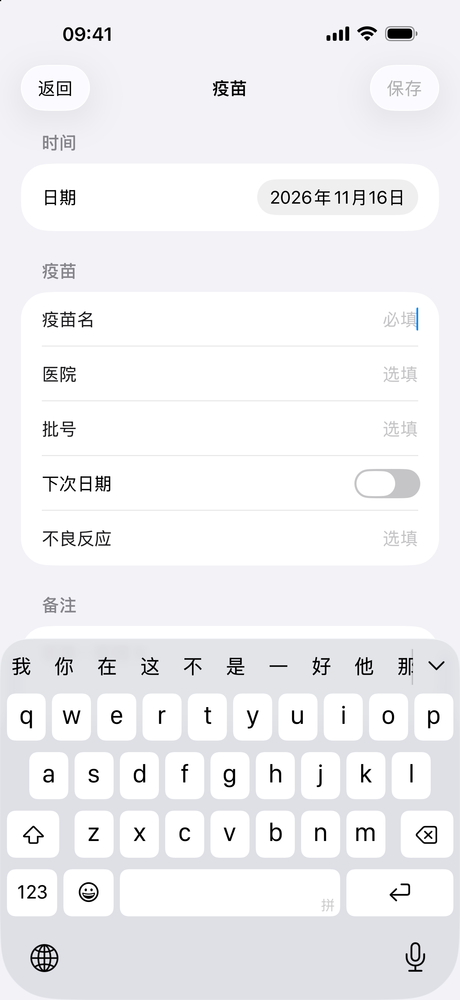
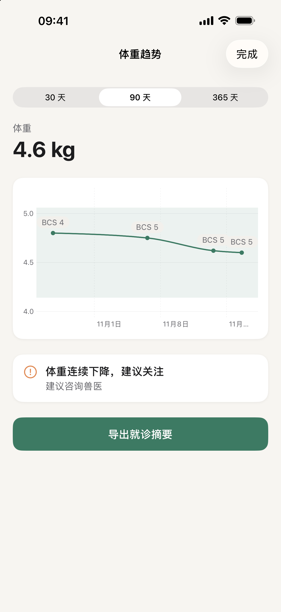
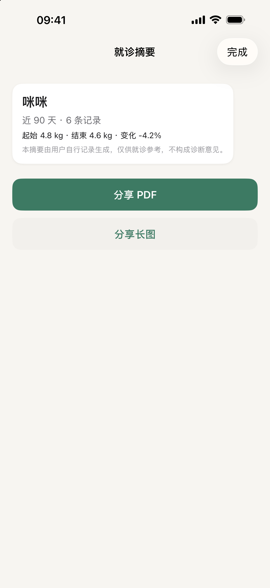
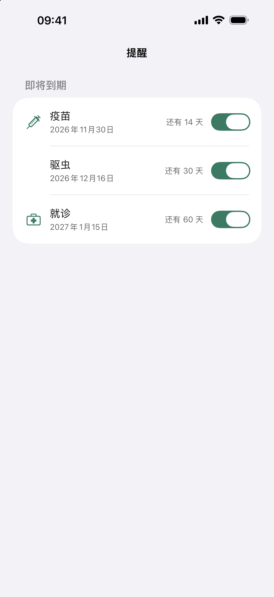
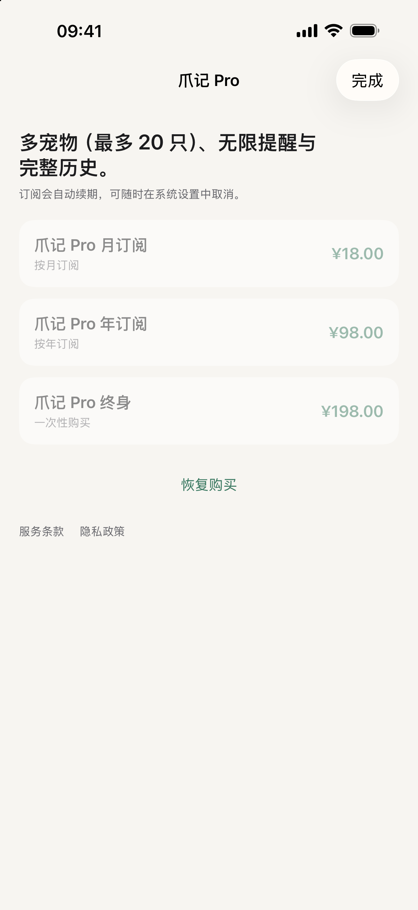

# 爪记 PawLog

> 给猫狗主人的私人病历本。30 秒记一条，看病时一页纸说清楚。

## 产品定位

面向养猫 / 养狗的个人用户：建档 → 7 类事件记录 → 时间线 → 周期提醒 → 体重趋势 → 就诊摘要一页 PDF。**数据 100% 本地存储**，无账号、无广告、无第三方追踪。

## 功能截图

以下为开源预览版（v1.0 草稿）的运行截图，使用 iPhone 16 Pro Max 模拟器（1320×2868）。所有数据为本地示例，不会写入你的设备。

| | | |
|---|---|---|
| 首页时间线 | 快速记录表单 | 体重趋势 |
|  |  |  |
| 就诊摘要预览 | 提醒列表 | 订阅（当前开源版隐藏） |
|  |  |  |

## 技术栈

| 层 | 选型 | 备注 |
|---|---|---|
| UI | SwiftUI + Observation (iOS 17+) | 除 PDF 渲染外不使用 UIKit |
| 语言 | Swift 6（严格并发） | `SWIFT_DEFAULT_ACTOR_ISOLATION = MainActor` |
| 持久化 | SwiftData | 5 个 `@Model`：Pet / Record / WeightEntry / Reminder / Attachment / Entitlement |
| 图表 | Swift Charts | 体重曲线 |
| 通知 | UserNotifications | 本地，静默时段 22:00–08:00 |
| PDF | PDFKit + UIGraphicsPDFRenderer | 就诊摘要离线生成 |
| 内购 | StoreKit 2 | 订阅代码已保留，开源版默认关闭 |
| 国际化 | String Catalog (`Localizable.xcstrings`) | 语义化 key（如 `record.type.vaccine.label`） |
| 依赖 | 零第三方 | 无 CocoaPods / SPM / Carthage |
| 最低系统 | iOS 17.0 | |
| Xcode | 26.0+（随 Swift 6 并发要求） | |

## 架构与分层

```
PawLog/
├── PawLogApp.swift               # App 入口
├── App/
│   └── ContentView.swift         # 5 段式 Tab：首页 / 时间线 / 中央 + / 健康 / 我的
├── Core/
│   ├── Models/                   # Pet · Record · WeightEntry · Reminder · Attachment · Entitlement
│   ├── Services/                 # 业务逻辑（View 只调 Service）
│   │   ├── EntitlementService    # 权益判定 / 限额（订阅开关在此生效）
│   │   ├── StoreKitService       # StoreKit 2：商品 / 购买 / 恢复 / Transaction.updates
│   │   ├── RecordService         # 记录 CRUD
│   │   ├── ReminderService       # 提醒派生 / 完成 / 调度同步
│   │   ├── NotificationService   # 本地通知排期（30/7/1 天 + 静默）
│   │   ├── WeightTrendService    # 体重点提取 + 变化提示
│   │   ├── SummaryPDFService     # 就诊摘要 PDF / 长图导出
│   │   └── PetService            # 宠物 CRUD + 排序
│   ├── DesignSystem/             # Theme.swift + 原子组件
│   └── Utils/                    # Clock 协议、WeightFormatter、PawLogConfig（订阅开关）
├── Features/<模块>/
│   ├── Pet/                       # 建档、排序、切换
│   ├── Timeline/                  # 时间线（日期倒序分组）
│   ├── Record/                    # 中央 + → 7 类记录表单
│   ├── Health/                    # 体重趋势 + BCS
│   ├── Summary/                   # 就诊摘要预览与导出
│   ├── Reminder/                  # 提醒列表（四组）
│   ├── Settings/                  # 设置页 + 关于
│   └── Subscription/              # Paywall（订阅代码保留）
├── Core/Utils/PawLogConfig.swift  # `isProEnabled: Bool = false`（开源版关闭）
└── Core/Services/...              # 所有业务逻辑
```

**依赖方向单向：View → Service → Model**。View 不直接写业务规则，也不直接改 SwiftData 数据，一律通过 Service 读写。订阅逻辑集中在 `EntitlementService`，UI 层只读 `isPro` 与限额常量，不自行判断。

### 订阅开关

`PawLogConfig.isProEnabled` 是一个仓库级布尔值：
- **`false`（当前开源版默认）**：所有用户视作 Pro，1 宠限制 / 3 提醒 / 90 天历史锁定全部不生效；Paywall 入口（PetListView、ReminderListView、TimelineView）不会触发；StoreKit 代码**仍然编译、测试仍然通过**，方便后续上架启用。
- **`true`（上架版）**：恢复免费 / Pro 分级，所有 Paywall 入口恢复弹出。

上架时只需改一处：把 `Core/Utils/PawLogConfig.swift` 中的 `isProEnabled` 改为 `true` 即可。

## 运行

```bash
git clone <this-repo>
cd PawLog
open PawLog.xcodeproj
```

- 用 Xcode 26（Swift 6 并发）打开；
- 无需 Apple ID、无需 Provisioning Profile（自动签名）、无需任何 API Key；
- 选一个 iPhone 模拟器（iOS 17+）按 ⌘R 运行；
- 测试 Scheme 已自带 `PawLog.storekit`，所以 SKTestSession 用例可以直连。

## 测试

```bash
xcodebuild -scheme PawLog -destination 'platform=iOS Simulator,name=iPhone 17 Pro' -only-testing:PawLogTests test
```

当前共 **86 条单元测试**，全部在 Service 层：

| 覆盖模块 | 用例 |
|---|---|
| EntitlementService | 购买 / 过期 / 撤销 / 恢复 / 限额 / 历史窗口锁定 |
| StoreKit (SKTestSession) | productID 与 `.storekit` 一致、购买解锁、退款回落、恢复还原 |
| ReminderService | 派生、重复排期、撤销、幂等、免费 / Pro 限额 |
| NotificationService | 时间偏移、静默、幂等、排期 / 取消 |
| NotificationActionHandler | 完成 /  snooze / 逾期汇总 |
| RecordService | 非体重记录不写 WeightEntry、体重更新同步 |
| SummaryPDF | PDF 页数、免责、长图尺寸 |
| WeightFormatter | 单位切换、范围、格式化 |
| LocalizationKey | `String(localized:)` 全部 key 在 Catalog 存在 |
| PetService | cascade 删除、排序 |
| QuickRecord | 必填字段、默认值 |

> 订阅逻辑的四个 SKTestSession 用例在 `PawLogTests/StoreKitConfigurationTests.swift`，测试内部显式注入 `proEnabled: true`，所以即使 `PawLogConfig.isProEnabled = false` 也能验证完整的 StoreKit 流程。

## 里程碑进度

| 里程碑 | 内容 | 状态 |
|---|---|---|
| M0 | 设计系统（Theme / Component / Radius / Typography） | ✅ |
| M1 | 数据模型（5 个 @Model）、档案 CRUD | ✅ |
| M2 | 7 类记录 + 时间线（日期倒序分组） | ✅ |
| M3 | 提醒派生 / 本地通知（30/7/1 + 静默 22–08） | ✅ |
| M4a | 体重趋势 + BCS + 变化提示 | ✅ |
| M4b | 就诊摘要 PDF / 长图导出 | ✅ |
| M5a | 设置页、语言、通知动作、逾期汇总 | ✅ |
| M5b | 订阅（StoreKit 2）+ 免费 / Pro 限额（宠物 / 提醒 / 历史） | ✅ |
| M5c | 开源发布准备：图标、隐私清单、README、许可证、订阅开关 | ✅ |

## 已知限制

- **无 CloudKit 同步 / 家庭共享**：这部分放在 v1.1。
- **订阅入口关闭**：`PawLogConfig.isProEnabled = false`，上架时打开。
- **v1 仅简体中文**：English 置灰并标注 `v1.1 支持`，不伪装切换。
- **无照片 / 位置权限**：应用不采集图片、通讯录、位置，Info.plist 里也不声明相册权限。
- **WidgetKit / App Intents**：当前未实现。
- **PDF 用 UIKit**：是项目中唯一的 UIKit 使用（UIGraphicsPDFRenderer）。

## 隐私清单

`PawLog/PrivacyInfo.xcprivacy`：
- `NSPrivacyTracking = false`
- `NSPrivacyCollectedDataTypes = []`
- `NSPrivacyAccessedAPITypes = UserDefaults / CA92.1`（仅偏好存储）

> 声明与**当前真实代码**一致。文件时间戳、磁盘空间等 API 都未被调用，所以不声明。

## 免责声明

本应用生成的就诊摘要仅供主人与兽医沟通参考，**不构成诊断或治疗建议**。PDF 页脚会显示同样的免责。

## 许可

本仓库以 MIT License 发布，见 [LICENSE](LICENSE)。
