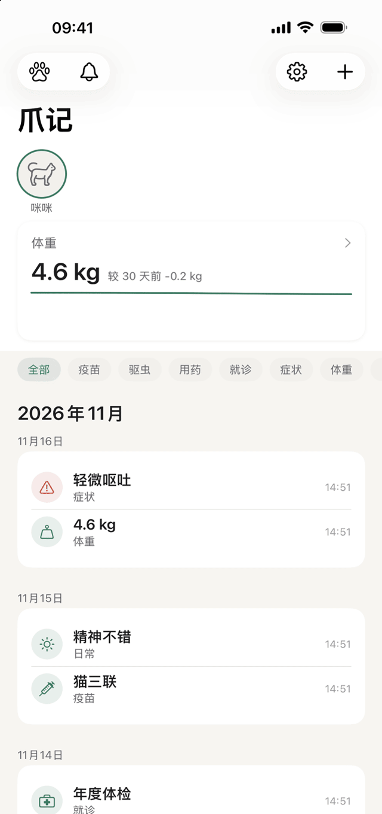
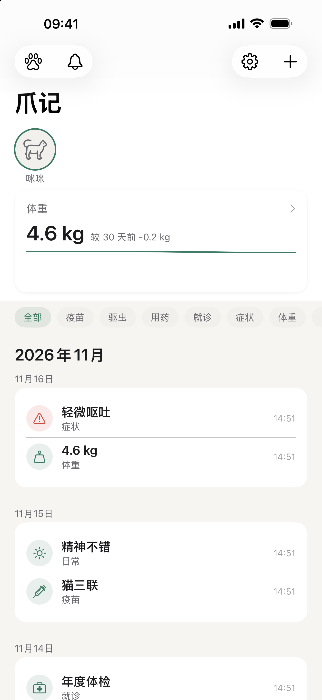

# 爪记 PawLog
> 宠物健康记录 App｜30 秒记一条，看病时一页纸说清楚
<!-- 真实操作录屏待补充，先以轮播动图占位 -->



📱 iOS 17+ · Swift 6 · SwiftUI · SwiftData · Swift Charts · 零第三方运行时依赖

## 截图

| | | |
|---|---|---|
| 首页时间线 | 体重趋势 | 就诊摘要预览 |
|  |  |  |

## 功能

- 宠物档案与切换（多宠、排序、归档）
- 7 类记录快捷录入（疫苗 / 驱虫 / 用药 / 就诊 / 症状 / 体重 / 日常）
- 时间线按日期倒序分组、同日折叠
- 体重趋势曲线 + 30 天变化提示 + BCS 评分
- 提醒（30/7/1 天周期、22–08 点静默、逾期汇总、通知内直接"已完成"回写）
- 就诊摘要 A4 PDF 与长图导出（离线生成，页脚固定免责）
- 设置页：单位（kg / lb）、语言跟随系统、恢复购买、关于

## 技术栈与架构

| 层 | 选型 |
|---|---|
| UI | SwiftUI + Observation (iOS 17+) |
| 语言 | Swift 6 严格并发（`SWIFT_DEFAULT_ACTOR_ISOLATION = MainActor`） |
| 持久化 | SwiftData |
| 图表 | Swift Charts |
| 通知 | UserNotifications（本地） |
| PDF | PDFKit + UIGraphicsPDFRenderer |
| 订阅 | StoreKit 2（开源版默认关闭） |
| 国际化 | String Catalog（`Localizable.xcstrings`，语义化 key） |
| 依赖 | 零第三方（无 SPM / CocoaPods / Carthage） |

**SwiftData 模型共 5 个**：`Pet` · `Record` · `WeightEntry` · `Reminder` · `Attachment` · `Entitlement`。`Pet` 与后四类是级联删除关系（删除宠物同时删除其全部记录 / 体重 / 提醒 / 附件）。

**Services 职责**：`PetService` CRUD + 排序；`RecordService` 记录写入与级联；`ReminderService` 派生 / 完成 / 同步调度；`NotificationService` 本地通知排期（30/7/1 天 + 静默 + 幂等）；`WeightTrendService` 体重点提取 + 变化阈值；`SummaryPDFService` 就诊摘要 PDF / 长图；`EntitlementService` 权益判定与限额（订阅开关在此生效）；`StoreKitService` 商品加载 / 购买 / 恢复 / `Transaction.updates`。

**唯一 UIKit 例外**：`SummaryPDFService` 里的 `UIGraphicsPDFRenderer` 用于 PDF 绘制。PRD 已明确这处例外，其余全部 SwiftUI。

依赖方向单向：View → Service → Model。View 不写业务规则，也不直接改 SwiftData 数据，一律通过 Service 读写。

## 快速开始

- **Xcode 26**（Swift 6 严格并发要求）
- **iOS 17.0** 部署目标
- 零配置：直接打开 `PawLog.xcodeproj` 按 ⌘R
- 无需 Apple ID、Provisioning Profile、任何 API Key（自动签名）

```bash
git clone https://github.com/xvsingue/PawLog.git
cd PawLog
open PawLog.xcodeproj
```

## 测试

```bash
xcodebuild -scheme PawLog \
  -destination 'platform=iOS Simulator,name=iPhone 17 Pro' \
  -only-testing:PawLogTests test
```

当前 **88 条单元测试**，全部在 Service 层：

- `EntitlementServiceTests` · `StoreKitConfigurationTests`（4 条 SKTestSession：productID 校验 / 购买解锁 / 退款回落 / 恢复还原）
- `ReminderServiceTests` · `ReminderRecordSyncTests` · `ReminderFreeLimitTests`
- `NotificationServiceTests` · `NotificationActionTests`
- `RecordServiceTests` · `PetServiceTests`（含级联删除与排序）
- `SummaryPDFTests` · `WeightTrendTests` · `WeightUnitTests`
- `LocalizationKeyTests`（`String(localized:)` 全部 key 在 Catalog 存在）
- `PawLogConfigTests`（订阅开关关闭时全用户视作 Pro、限额放开；打开时免费限额恢复）
- `QuickRecordDefaultsTests`（默认值 / 必填字段）

订阅开关在测试里显式注入 `proEnabled: true`，所以即使开源版默认关闭，StoreKit 四个用例仍直连 `.storekit` 通过。

## 里程碑进度

| 里程碑 | 内容 | 状态 |
|---|---|---|
| M0 | 设计系统（Theme / Component / Radius / Typography） | ✅ |
| M1 | 5 个 @Model + Pet CRUD | ✅ |
| M2 | 7 类记录 + 时间线（日期倒序分组） | ✅ |
| M3 | 提醒派生 / 本地通知（30/7/1 天 + 静默 22–08） | ✅ |
| M4a | 体重趋势 + BCS + 变化提示 | ✅ |
| M4b | 就诊摘要 PDF / 长图导出 | ✅ |
| M5a | 设置页、语言、通知动作、逾期汇总 | ✅ |
| M5b | StoreKit 2 订阅 + 免费 / Pro 限额 | ✅ |
| M5c | 开源发布准备：图标、隐私清单、README、许可证、订阅开关 | ✅ |

## 已知限制

- **无 CloudKit / 多设备同步**（留 v1.1，PRD 5.7 家庭共享随 CloudKit 提供）
- **v1 仅简体中文**：English 置灰并标注 `v1.1 支持`，不伪装切换
- **订阅入口默认关闭**：`PawLogConfig.isProEnabled = false`，上架时改为 `true` 即可恢复 1 宠 / 3 提醒 / 90 天历史锁定
- **无相册 / 位置权限**：应用不采集图片、通讯录、位置，Info.plist 不声明相册权限
- **WidgetKit / App Intents**：当前未实现

## 免责声明

本应用生成的就诊摘要由用户自行录入，仅供主人与兽医沟通参考，**不构成诊断或治疗建议**。PDF 页脚会显示同样的免责。

## 支持这个项目

爪记是我用业余时间独立开发的开源项目：没有广告、没有内购、没有云同步，所有数据都保存在你自己的设备上。

如果它帮你省下过一次"病历说不清"的麻烦，可以请我喝杯咖啡。打赏完全自愿，不打赏也能使用全部功能。

<table>
  <tr>
    <td align="center"><b>微信</b><br/></td>
    <td align="center"><b>支付宝</b><br/></td>
  </tr>
</table>

## License

本仓库以 MIT License 发布，见 [LICENSE](LICENSE)。
